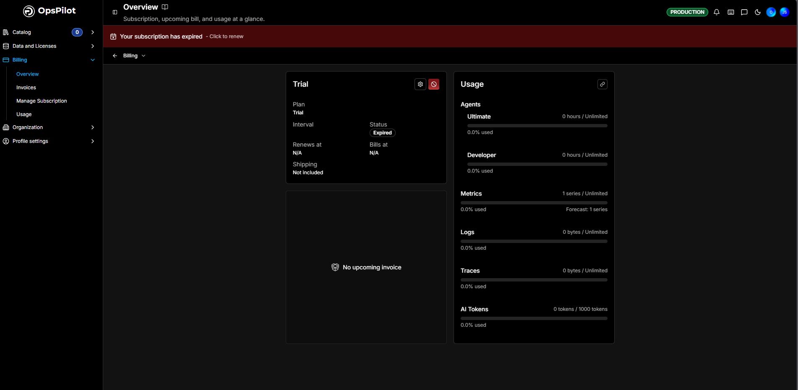

# Billing

OpsPilot uses a unified billing model that covers both on-premise and cloud usage in one place.

If you’re already running the FusionReactor agent on-premise, you can enable OpsPilot cloud features with a single click - no migration, no reconfiguration, and no change to your existing FusionReactor pricing. The FusionReactor agent costs the same whether it runs purely on-premise or connected to OpsPilot.

To get started, sign up for a free, no-obligation [trial](https://app.opspilot.com/auth/register). All plan and subscription management is handled within the app.

## Billing Overview

The **Billing Overview** gives you your subscription, upcoming bill, and usage at a glance. Open it from **Billing > Overview** in the left-hand menu.

If your subscription has lapsed, a **Your subscription has expired - Click to renew** banner sits across the top.

### Subscription summary

The subscription card is headed with your current plan name (for example **Trial**) and shows:

| Field | Description |
|---|---|
| **Plan** | Your current plan |
| **Interval** | Monthly or yearly billing |
| **Status** | For example **Expired**, or active |
| **Renews at** | When the subscription next renews, or **N/A** |
| **Bills at** | When the next bill is raised, or **N/A** |
| **Shipping** | Whether metric shipping is included |

A **settings** icon and a **cancel subscription** icon sit in the card's top right. Below it, an **upcoming invoice** panel shows your next bill, or **No upcoming invoice** when there is none.

### Usage

The **Usage** card tracks your consumption against your plan allowance, each item with a progress bar and a **% used** figure:

| Item | Measured in |
|---|---|
| **Agents - Ultimate** | FusionReactor Ultimate agent hours |
| **Agents - Developer** | FusionReactor Developer agent hours |
| **Metrics** | Active metric series, with a **Forecast** for the period |
| **Logs** | Bytes ingested |
| **Traces** | Bytes ingested |
| **AI Tokens** | OpsPilot AI tokens used, against your plan's allowance |

## Purchasing a subscription

Choose and buy a plan from the **[Manage Subscription](../manage-subscription.md)** page - **Billing > Manage Subscription**. It covers the Starter, Pro, and Advanced plans, the optional add-ons, currency preview, and checkout.

---

## What's included

|**Plan**| **Price** | **Metrics** | **Logs** | **Traces** | **OpsPilot tokens**|
|------------ | ------------- | ------------ | ----------- | ------ |-----|
**Trial** | FREE | Unlimited |Unlimited| Unlimited| 1,000 |
**Starter** | $49 (A)   $59 (M) | 10,000 | 25 | 25 | 500 |
**Pro** | $249 (A)   $299 (M) | 20,000 | 100 | 100 | 5,000 |
**Advanced** | $899 (A)   $1,079 (M) | 50,000 | 250 | 250 | 20,000 |
**FusionReactor Ultimate** | $79 (A)  $95 (M) /seat | 5,000 | 2 GB | 2 GB | - |
**FusionReactor Developer** | $25/mo /seat | - | - | - | - |
**Metric Shipping** | $59/mo | - | - | - | - |
**Historical data retention** | | 13 months | 30 days | 30 days | - |

!!! info
    Custom dashboards are available on all plans at no additional cost.

!!! note
    Additional [on-demand](/Admin-and-data/Billing/Cloud/overview/#on-demand-usage-costs) usage outside of the plan is chargeable.

## Plans

### Starter

The **Starter** plan is recommended for observability, distributed tracing, infrastructure monitoring, and log management. It has a base cost of $49/mo (annual) or $59/mo (monthly), which includes:

| **Metrics** | **Logs** | **Traces** | **OpsPilot tokens** |
|:---:|:---:|:---:|:---:|
| 10,000 | 25 GB | 25 GB | 500 |

!!! info "Learn more"
    [On-demand usage costs](/Admin-and-data/Billing/Cloud/overview/#on-demand-usage-costs)

### Pro

The **Pro** plan provides increased allowances and OpsPilot AI on-demand with customisable dashboards. It has a base cost of $249/mo (annual) or $299/mo (monthly), which includes:

| **Metrics** | **Logs** | **Traces** | **OpsPilot tokens** |
|:---:|:---:|:---:|:---:|
| 20,000 | 100 GB | 100 GB | 5,000 |

!!! info "Learn more"
    [On-demand usage costs](/Admin-and-data/Billing/Cloud/overview/#on-demand-usage-costs)

### Advanced

The **Advanced** plan unlocks the full potential of OpsPilot as a DevOps co-pilot with advanced AI capabilities. It has a base cost of $899/mo (annual) or $1,079/mo (monthly), which includes:

| **Metrics** | **Logs** | **Traces** | **OpsPilot tokens** |
|:---:|:---:|:---:|:---:|
| 50,000 | 250 GB | 250 GB | 20,000 |

!!! info "Learn more"
    [On-demand usage costs](/Admin-and-data/Billing/Cloud/overview/#on-demand-usage-costs)

### FusionReactor monitoring

**FusionReactor** agent monitoring is purchased separately from the cloud plans - you only need it if you want FusionReactor monitoring, and you pay for the on-premise seats you use. Add it from the **FusionReactor APM** option on [Manage Subscription](../manage-subscription.md).

| | **Price** |
|---|---|
| **FusionReactor Ultimate** | $79 (A) / $95 (M) per seat |
| **FusionReactor Developer** | $25/mo per seat |

The total cost depends on the number of Ultimate and Developer seats you use. Optionally add **Metric Shipping** ($59/mo) to ship agent data to third-party providers.

!!! warning
    The Developer edition is not licensed for production use.

!!! info "Learn more"
    [FusionReactor licensing](../../Licensing/Licensing.md)

### Custom pricing

Need a large number of seats or a tailored plan? Contact our Sales Team for custom pricing.

## OpsPilot AI 

**OpsPilot AI** is an advanced observability solution that leverages generative AI to provide powerful insights into the performance of your applications. Using OpsPilot AI tokens enables you to identify and resolve issues before they occur, optimize the performance of your applications, and reduce downtime.

!!! info "Learn more"
    [OpsPilot Coworker](/Data-insights/Features/OpsPilot/Coworker/overview/)

!!! warning 
    As the OpsPilot AI uses previous prompts and responses to reply to a query, long involved responses can prove costly.

## FusionReactor Ultimate Reservations

Customers running the FusionReactor agent can optionally reserve **FusionReactor Ultimate** seats to manage costs and avoid on-demand billing. Seats are priced at $79/mo (annual) or $95/mo (monthly).

A seat covers a single unique virtual or physical host with up to 4 instances of Java/ColdFusion installed, or up to 4 Docker containers.

!!! example
    5–8 instances on a host requires 2 seats.

!!! note
    It is possible to be billed fully on-demand with no seat reservation required.

!!! info "Learn more"
    [FusionReactor Ultimate](#fusionreactor-ultimate)

## On-demand

FusionReactor Agent is also  billable fully on-demand. In these cases it will not include the logs, metrics and traces usage which will be billed in addition to the hourly cost of using an agent.  

!!! note 
    Customers will always have to purchase the **Starter** plan, which includes the set number of metrics, logs, traces, OpsPilot tokens and snapshots. 

### On-demand usage costs

OpsPilot, logs, metrics, and traces are all available at on-demand rates for those who go over the included allowance in the base cost and OpsPilot Ultimate.

FusionReactor agent instances will continue to be billed at $0.13 per hour, but their metrics, logs and traces will be charged additionally.

On-demand data will be charged at:

| **FR instance**| **Metrics** | **Logs** | **Traces** | **OpsPilot tokens**| **Snapshots/Profiles** |
|:------------:| :-------------: | :------------:| :-----------: |  :-----------: | :-----------: | 
|  $0.13 /hour|$10 /1K  | $0.5 /1 GB |  $0.5 /1 GB  |$20 for 250 | $0.5 /1 GB |

!!! info 
    [How to reduce costs in OpsPilot](/Troubleshooting/Optimize-data/)
    

## Usage calculations

Both annual and monthly plan usage is calculated and billed each month. 

|Data type|Description |
|--- |--- |
|**FR hours**|Calculated by performing a **sum** of all values over the billing period. |
|**Metrics**|Calculated by performing a **mean average** for the billing period|
|**Logs**|Calculated by performing a **sum** of all values over the billing period.|
|**Traces**|Calculated by performing a **sum** of all values over the billing period.|
|**OpsPilot tokens**|Calculated by performing a **sum** of all values over the billing period.|

## Usage dashboards

To help keep things simple and transparent, **OpsPilot** has developed usage dashboards that allow you to visually track your billing data. You can also create alerts to fire if you exceed the allowed usage. These dashboards are located in **Billing Dashboards** where you can access **Data Usage** to calculate your approximate usage and the **Billing Usage** dashboard for a breakdown of your bill.

### Data usage

The data usage dashboard calculates the approximate usage of the FusionReactor instance, metrics, logs and traces. It displays the raw values or unedited data you have sent to OpsPilot. 

#### FusionReactor agent instance

The first total in the graph relates to the FusionReactor agent instances and provides the number of hours the instance has been used, over both the 30-day period and the last 24 hours.

#### Metrics

In the **Metrics** section of the dashboard you can view the maximum number of metric series over the 30 day period, with the figure for the last 24 hours below it.

!!! note
    For billing purposes, your account will never be at zero. We will add some metrics to your account in order to measure account usage.

#### Logs 

In the **Logs** section of the dashboard you can view the total number of logs that have been ingested over the 30 day period, with the figure for the last 24 hours below it.

#### Traces

In the **Traces** section of the dashboard you can view the total number of traces that have been ingested over the 30 day period, with the figure for the last 24 hours below it.

#### Data usage metrics

These are the current metrics OpsPilot supports for billing. 

**fr_usage_minutes**: The amount of time used by running FR instances (per minute).

**fr_logs_bytes_received**: The amount of logs ingested into your account (per hour).

**fr_traces_bytes_received**: The amount of traces ingested into your account (per hour). 

**fr_metrics_series_count**: The number of metric series ingested into your account (per hour).

### Billing usage 

At **OpsPilot** we have created the **Billing usage** dashboard to ensure cost transparency. This dashboard displays a breakdown of your billing usage into clearly defined sections to help you keep on top of your spending. 

The dashboard provides the following:

* Plan cost

* Seat cost

* Additional Usage cost

* Total cost

To the right of the costs overview is a pie chart which visually displays your costs according to:

* Plan

* Seats

* Agents

* Metrics

* Logs

* Traces

The dashboard also provides detailed breakdowns for metrics, logs, traces and the FR agent of the following: 

* Current Usage

* Additional Usage

* Additional Charge Cost

Alongside each data source is a graph that provides further information on your usage as three different categories: Additional (green), Included (yellow), and Billed Total (blue). Any usage above the yellow line on the graph will be billed at on-demand rates.

#### Create an alert

To control your usage and spending costs it is possible to create an alert to fire if you exceed the allowed usage. 

!!! info "Learn more"
    [Create an alert rule](/Data-insights/Features/Alerting/Alert-Rules/Configure-rules/)

#### Example billing usage checks

For instructions on configuring billing alerts, see the [Billing checks](/Data-insights/Features/alerting-examples/#billing-checks) section. The following data usage metrics are available for alerting:

* `fr_logs_bytes_received`
* `fr_traces_bytes_received`
* `fr_metrics_series_count`
* `fr_usage_minutes`

---

---

## Modifications

It is important to note that any upgrades you make to your billing plan occur immediately while downgrades will only come into effect at the end of the billing period. 

___

!!! question "Need more help?"
    Contact support in the chat bubble and let us know how we can assist.
