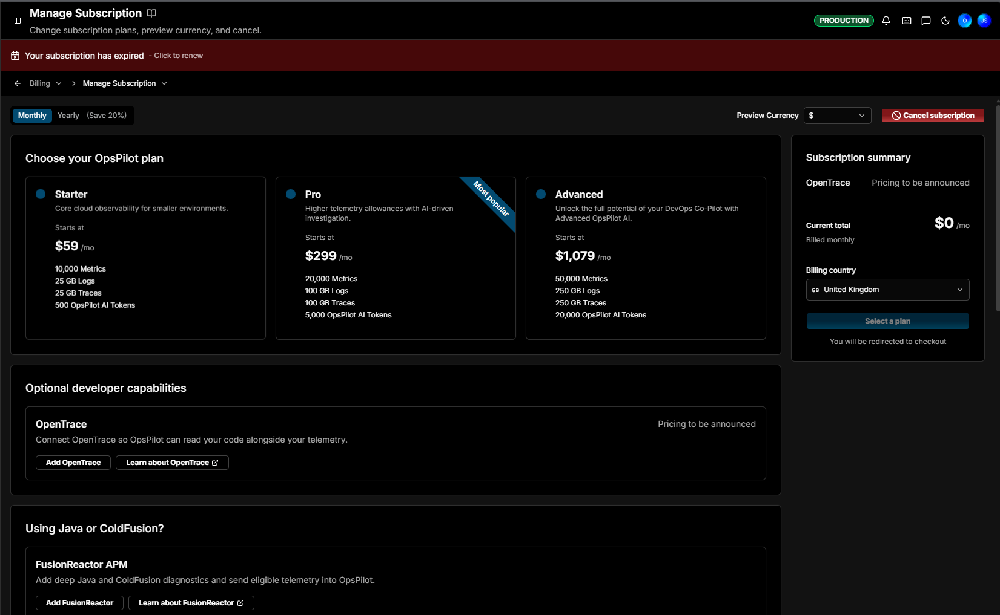

# Manage Subscription

**Manage Subscription** is where you choose a plan, add optional developer capabilities, preview pricing in your currency, and cancel. Navigate to **Billing > Manage Subscription** to open it.

A **Monthly** / **Yearly** toggle at the top left sets the billing interval - **Yearly saves around 20%**. In the top right, **Preview Currency** switches the prices shown (for example `$` or `£`), and **Cancel subscription** sits beside it.

## Choose your plan

OpsPilot offers three plans. Each card shows a short description, its starting price, and its included allowances:

| Plan | Starts at (monthly) | Metrics | Logs | Traces | OpsPilot AI Tokens |
|---|---|---|---|---|---|
| **Starter** | $59/mo | 10,000 | 25 GB | 25 GB | 500 |
| **Pro** *(Most popular)* | $299/mo | 20,000 | 100 GB | 100 GB | 5,000 |
| **Advanced** | $1,079/mo | 50,000 | 250 GB | 250 GB | 20,000 |

- **Starter** - Core cloud observability for smaller environments.
- **Pro** - Higher telemetry allowances with AI-driven investigation.
- **Advanced** - Unlock the full potential of your DevOps Co-Pilot with Advanced OpsPilot AI.

Switch the toggle to **Yearly** to see annual pricing, which saves around 20%.

!!! info "Learn more"
    [What's included](Cloud/overview.md#whats-included) lists the full allowances and on-demand rates for each plan.

## Optional developer capabilities

Two optional add-ons can be included with any plan. Each has an **Add** button and a **Learn about** link:

| Add-on | What it does | Pricing |
|---|---|---|
| **OpenTrace** | Connect OpenTrace so OpsPilot can read your code alongside your telemetry. | Pricing to be announced |
| **FusionReactor APM** | Add deep Java and ColdFusion diagnostics and send eligible telemetry into OpsPilot. Shown under **Using Java or ColdFusion?** | - |

## Subscription summary and checkout

The **Subscription summary** on the right itemizes your selection - the plan, any FusionReactor **Ultimate** and **Developer** seats, **Metric shipping**, and **OpenTrace** - each with its price, and totals them as the **Current total** per month or year. Set your **Billing country**, used to calculate tax, then click **Select a plan** to be redirected to checkout.

## Frequently asked questions

The page ends with a **Frequently asked questions** section that answers the common billing questions in place:

- **What are the allowances for each plan?** and **How long is my data retained?** - the same figures as [What's included](Cloud/overview.md#whats-included).
- **What is included with OpsPilot cloud plans?** - the platform capabilities plus your selected allowances for metrics, logs, traces, and OpsPilot AI tokens. **FusionReactor seats are separate**, and only needed if you want FusionReactor monitoring.
- **What are the on demand data rates?** - the overage rates for usage beyond your plan, listed in your [on-demand](Cloud/overview.md#on-demand-usage-costs) rates.
- **How do OpsPilot AI tokens work?** - tokens are the unit of measure for AI activity, consumed in proportion to the complexity of each query, investigation, or automated check. Your monthly allowance is included in your plan, unused tokens do not carry over, and any overage is billed at **$20 per 250 tokens**.

!!! question "Need more help?"
    Contact support in the chat bubble and let us know how we can assist.
