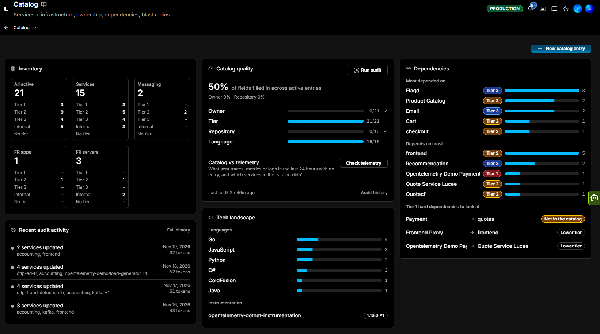

# Catalog Overview

The Service Catalog is a persistent record of everything you run - your services and the infrastructure they depend on. Unlike the Services overview, which only shows what is currently sending telemetry, the catalog tracks entries whether they are active or quiet. It gives every service an owner, a tier, and a home, so when something breaks at 2am, nobody has to guess who to contact or what is affected.

The catalog is also the brain behind Coworker. When Coworker investigates an alert or runs a check, it draws on catalog entries to understand what a service does, who owns it, what it depends on, and what has happened to it before. That pre-loaded context means Coworker spends fewer AI Tokens rediscovering information it could already know - and produces better investigations as a result. The more complete your catalog, the more effective Coworker becomes.

The catalog also powers incident response: affected services on an incident link directly to their catalog entries, runbooks surface based on catalog service matches, and Analytics surfaces which catalog entries appear most frequently in incidents.

The Catalog landing page is a dashboard that summarizes your catalog at a glance, with **+ New catalog entry** in the top right. Create and manage entries on the [Entries](entries.md) page.

## Inventory

**Inventory** breaks your active entries down by category - **All active**, **Services**, **Messaging**, **FR apps**, and **FR servers** - each showing a total and a split by **tier** (Tier 1, Tier 2, Tier 3, Internal, No tier).

## Catalog quality

**Catalog quality** scores how complete your catalog is - the percentage of fields filled across active entries - with a bar per key field (**Owner**, **Tier**, **Repository**, **Language**) showing how many entries have it.

- **Run audit** re-runs discovery to create and refresh entries - see [Adding a catalog entry](entries.md#adding-a-catalog-entry).
- **Catalog vs telemetry** (**Check telemetry**) compares what sent telemetry in the last 24 hours against what is cataloged - flagging services with no entry, and entries with no telemetry.

It also shows when the **last audit** ran, with an **[Audit history](audit-history.md)** link.

## Dependencies

**Dependencies** ranks entries by how they connect, each row showing the entry's tier and a count:

- **Most depended on** - the entries the most other services rely on
- **Depends on most** - the entries that rely on the most others
- **Tier 1 hard dependencies to look at** - risky dependencies for your critical services, flagged **Not in the catalog** or **Lower tier**

## Recent audit activity

**Recent audit activity** lists the latest audits - what was updated, when, and the **OpsPilot AI Token** cost - with a **[Full history](audit-history.md)** link.

## Tech landscape

**Tech landscape** summarizes the technology across your catalog: a breakdown of **Languages** (such as Go, JavaScript, Python), and the **Instrumentation** in use (such as `opentelemetry-dotnet-instrumentation`).

---

!!! question "Need more help?"
    Contact support in the chat bubble and let us know how we can assist.
