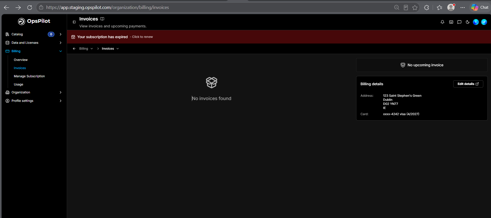

# Invoices

The **Invoices** page lets you view your invoices and upcoming payments. Open it from **Billing > Invoices**.

The main panel lists your past invoices, or reads **No invoices found** when there are none. Each invoice shows:

| Field | Description |
|---|---|
| **Invoice ID** | A unique identifier for the invoice |
| **Status** | Payment status (e.g. paid, pending) |
| **Date** | The date the invoice was issued |
| **Amount** | The total amount charged |

Click the download icon on the right of any invoice to download it as a PDF.

## Upcoming invoice

The **upcoming invoice** panel on the right shows your next payment - the amount due, the next billing date, and a breakdown of **Subtotal**, **VAT**, **Total**, and **Credit**. It reads **No upcoming invoice** when none is due.

## Billing details

The **Billing details** card shows the **Address** and **Card** on file for your account. Click **Edit details** to update your card or billing information.

---

!!! question "Need more help?"
    Contact support in the chat bubble and let us know how we can assist.
