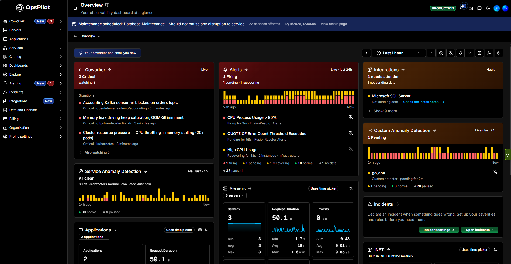

# Overview

The **Overview** page is your observability dashboard at a glance. It gives you an immediate, high-level summary of your entire environment - integrations, services, servers, applications, alerts, and anomaly detection - all in one place.

## Active account view

Once your environment is sending data, the Overview page shows a full observability summary laid out across several columns. Each panel has a header with a collapse control, its title, an arrow to the full view, and a status label (for example **Health**, **Live**, or **Last 1 hour**). Where a panel sits depends on your layout - [pinning and visibility](#customizing-your-dashboard) decide what shows and in what order. A **time picker** in the top right sets the range for the time-based panels, which are marked **Uses time picker**.

## Customizing your dashboard

Click the **My dashboard** icon in the top right of the Overview to control which panels appear and in what order. Each panel in the list has two controls:

- A **visibility** toggle - tick or untick a panel to show or hide it.
- A **pin** - pin a panel to keep it at the top of the Overview (see [Pinning panels](#pinning-panels)).

The list covers the core panels - **Coworker**, **Integrations**, **Services**, **Servers**, **Applications**, **Alerts**, **Service Anomaly Detection**, **Custom Anomaly Detection**, and **Incidents** - followed by a panel for each installed integration, named after its dashboard folder (for example **AWS · Database** or **Java · Semantic conventions**).

Click **Reset to org defaults** to restore the default layout.

### Pinning panels

Panels on the Overview are ordered automatically - anything **warning** or **erroring** floats to the top so it catches your eye first. **Pinning** overrides that: a pinned panel always sits above the rest, even when nothing is wrong.

You can pin at two levels:

- **Organization** - the default layout everyone in the org sees.
- **User** - your own overrides on top of those org defaults.

Pinning an **integration** panel does one more thing: it associates that panel's **dashboard folder** with your dashboard list, so the folder appears in the left-hand nav under [Dashboards](Dashboards/about-dashboards.md) - putting its dashboards one click away.

### Integrations

The **Integrations** panel shows the health of your installed integrations, color-coded by worst state, with a **Health** label. A banner at the top summarizes how many **need attention** and how many are **not sending data**.

Below it, each integration shows a status dot and its state - green for **Healthy**, or amber for **Not sending data**, which adds a **Check the install notes →** link to its setup guide. **Show more** and **Show less** expand and collapse the full list.

Click **Integrations →** to go to the full [Integrations](/Data-insights/Features/integrations/) view.

### Coworker

The **Coworker** panel gives you a live summary of your AI teammate's activity, with a **Live** label. Its header counts what Coworker is **watching** and how many it is **investigating**.

Under **Situations**, situations are grouped by severity - for example a **Critical** heading with a count, listing those situations below it. Each shows its severity, the affected service, a one-line summary (for example, *"fr-next-ui 100% errors; external dependency (Clerk API) latency elevated"*), and how long ago it changed. **Also watching N** rolls up the rest that Coworker is keeping an eye on.

An **Investigating** section lists what Coworker is actively looking into right now - each entry naming the service, what it is investigating (for example, *Frontend Call p95 Latency*), and the kind of check, such as a **Health screen**.

Click a situation to open it in the full Coworker view, or **Coworker →** to go to the full Coworker dashboard.

### Services

The **Services** section displays key performance metrics aggregated across all your monitored services for the last hour, shown as a row of stat cards. Each card shows the metric's current value; the **Show min, avg and max** control in the panel header expands the cards to add each value's **MIN**, **AVG**, and **MAX** across the range, with count-based cards (**Errors** and **Throughput**) showing **SUM**, **AVG**, and **MAX** instead.

| Card | Description |
|---|---|
| **Service names** | The services included in the summary, with a count and a sample of names |
| **Services** | Total number of monitored services |
| **Latency** | Average request latency across all services |
| **P95** | 95th percentile latency |
| **P99** | 99th percentile latency |
| **Errors** | Number of errors per second across all services |
| **Throughput** | Number of requests per second |

#### Services by latency

Below the summary metrics, **Services by latency** lists your top 10 services ranked by average latency over the last hour. Each service card shows:

- **Latency**
- **P95 / P99**
- **Errors**
- **Throughput**

Click any service card to drill into that service's detailed performance data.

### Servers

The **Servers** section provides a summary of all servers running a FusionReactor agent, shown as stat cards with the same **Show min, avg and max** toggle as Services (count-based cards show **SUM**, **AVG**, and **MAX**):

- **Server names** - the servers included, with a count and a sample of names
- **Servers** - total number of servers
- **Request Duration**
- **Errors**
- **Throughput**
- **CPU Usage**
- **Memory Usage**

#### Servers by latency

Lists your servers ranked by average latency. Each card shows **Request Duration**, **Errors**, **Throughput**, **CPU**, and **Memory**.

Click **Servers ->** to go to the full [Servers](/Data-insights/Features/Servers/overview/) view.

### Applications

The **Applications** section summarizes all monitored applications, shown as stat cards with the same **Show min, avg and max** toggle (count-based cards show **SUM**, **AVG**, and **MAX**):

- **Application names** - the applications included, with a count and a sample of names
- **Applications** - total number of applications
- **Request Duration**
- **Errors**
- **Throughput**

#### Applications by latency

Lists your applications ranked by average latency. Each card shows **Request Duration**, **Errors**, and **Throughput**.

Click **Applications ->** to go to the full [Applications](/Data-insights/Features/applications/) view.

### Integration and runtime panels

Each installed integration can add its own panel to the Overview - for example a **.NET** panel of built-in runtime metrics, or a database integration's dashboard folder. These follow the time picker (**Uses time picker**) and surface the integration's key stat cards. Pin or hide them from [My dashboard](#customizing-your-dashboard).

### Panel anomaly detectors

The metric panels - **Services**, **Servers**, **Applications**, and the integration panels - can run an **anomaly detector** on each metric they show. A panel with none enabled reads **Anomaly detectors off** in its header, with a **Choose detectors to switch on** link. That opens the list: each metric (for example **Services**, **Latency**, **P95**, **P99**, **Errors/s**, **Throughput**) has a toggle to switch its detector on or off. A row reads **Off** until you enable it, and then shows the detector's state - **Normal** or **Pending**.

A detector does nothing until it is switched on, and then needs a **warm-up period** to learn what is normal before it can alert. You enable detectors per metric (bulk enabling is coming).

Once a detector is on, the panel's header reflects it - for example **2 pending**, naming which metrics are pending (*P99 pending · Errors/s pending*) - and a panel whose detector is breaching shows a **firing** count.

### Alerts

The **Alerts** panel, with a **Live** label, reads **All clear** when nothing is firing (for example, *1 of 124 rules normal*). When alerts are firing it leads with the number **firing** and lists them - each showing the alert name, how long it has been firing, and its rule group (for example *OpsPilot Rules* or *FusionReactor Alerts*). A muted-bell icon marks a silenced alert.

Below the list, **Open in Alerting** links to the full view, with a breakdown of every rule by state:

| State | Description |
|---|---|
| **Firing** | Alerts currently breaching their threshold |
| **Can't evaluate** | Rules that could not be evaluated |
| **Pending** | Alerts that have triggered but are not yet confirmed |
| **Normal** | Alert rules currently within threshold |
| **No data** | Rules with no data to evaluate against |
| **Paused** | Rules that are not currently evaluating |

Click **Alerts →** to go to the full [Alerting Status](/Data-insights/Features/New-alerting/status/) view.

### Service Anomaly Detection

The **Service Anomaly Detection** panel, with a **Live** label, tracks the detectors OpsPilot maintains for your services. It reads **All clear** when none are active (for example, *30 of 36 detectors normal*), and otherwise lists the firing and **pending** anomalies - each with its detector, the affected service, and how long it has been pending - above a breakdown of every detector by state (**pending**, **normal**, **no data**, **paused**).

Click **Service Anomaly Detection ->** to go to the full [Anomaly Detection](/Data-insights/Features/New-alerting/service-anomaly-detectors/) view.

### Custom Anomaly Detection

The **Custom Anomaly Detection** panel, with a **Live** label, does the same for the custom detectors you have defined. It reads **All clear** when none are active, and otherwise lists any firing or **pending** custom anomalies - each naming the detector and how long it has been pending (for example, *go_cpu · pending for 2m*) - above the same state breakdown.

Click **Custom Anomaly Detection ->** to go to the full [Custom detectors](/Data-insights/Features/New-alerting/custom-anomaly-detectors/) view.

### Incidents

The **Incidents** panel tracks your open incidents. Before incidents are set up, it shows a **Declare an incident when something goes wrong** prompt with **Incident settings** and **Open incidents** buttons. Once configured, it reads **No open incidents** when there are none, and otherwise breaks your open incidents down by state - **Triage**, **Investigating**, and **Mitigated** - listing each with its title, severity (such as **SEV-2**), and how long ago it was raised.

Click **Incidents ->** to go to the full [Incidents](/Data-insights/Features/Incidents/overview/) view.

## No Data view

If your account has no data yet, each section of the Overview displays a **Get Started** prompt to guide you through setup:

| Section | Prompt |
|---|---|
| **Services** | You'll need an API key to instrument your application with OpenTelemetry. |
| **Servers** | Install FusionReactor on your servers to start monitoring. You'll need a license key. |
| **Applications** | Install FusionReactor to monitor your applications. You'll need a license key. |
| **Coworker** | Set up your AI Coworker to investigate alerts and track ongoing situations across the services you care about. |
| **Alerts** | Configure alert rules to monitor your infrastructure. |
| **Anomaly Detection** | Enable anomaly detection to automatically detect unusual behavior in your data. |

The **Servers** and **Applications** prompts also display your **OpsPilot license key** directly on the page so you can copy it for use during agent installation.

Once data starts flowing in, the Overview automatically populates with your live metrics and telemetry.

!!! tip "Getting started"
    Follow the prompts on the Overview page to install the right agent or instrumentation for your stack, then return to the Overview to see your data appear.

---

!!! question "Need more help?"
    Contact support in the chat bubble and let us know how we can assist.
